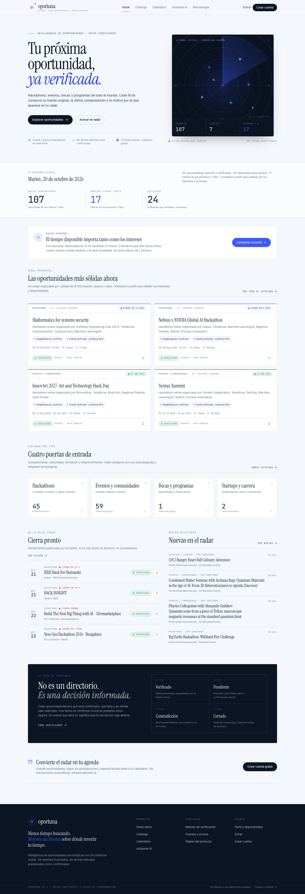
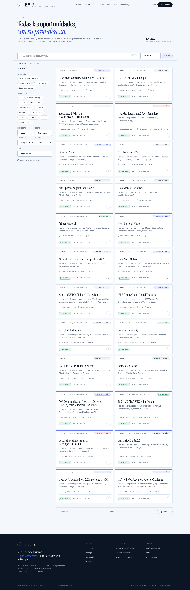
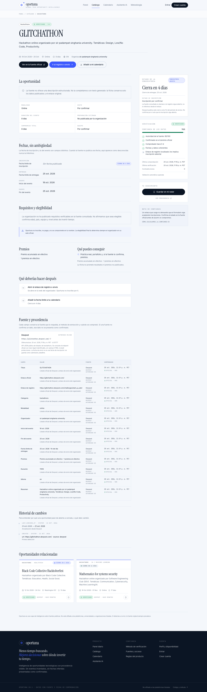
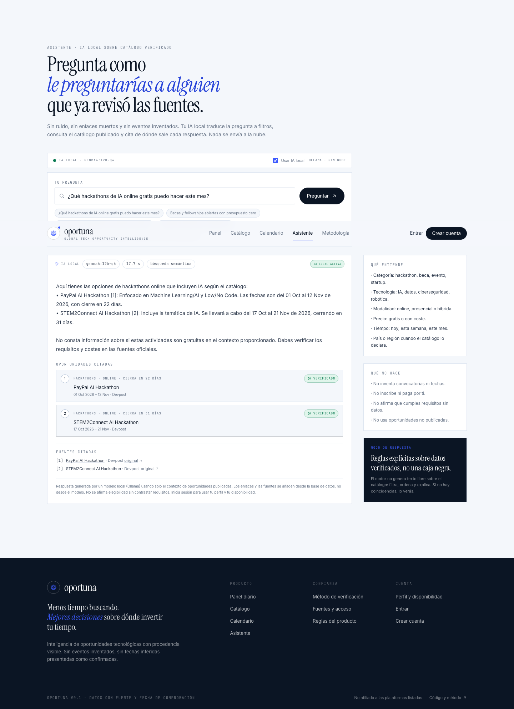
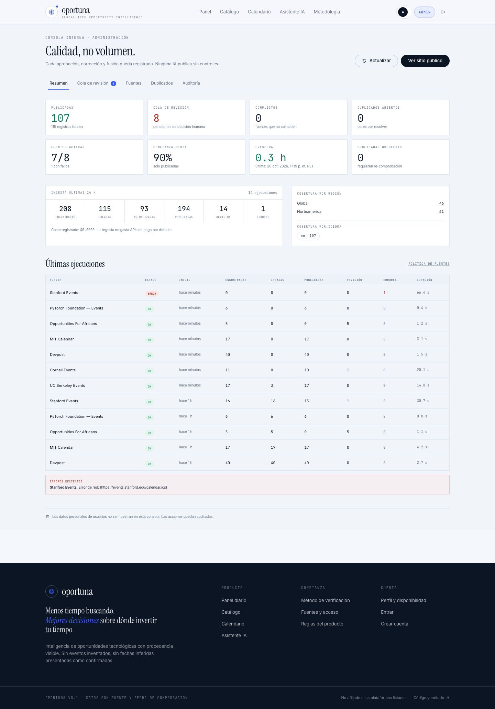
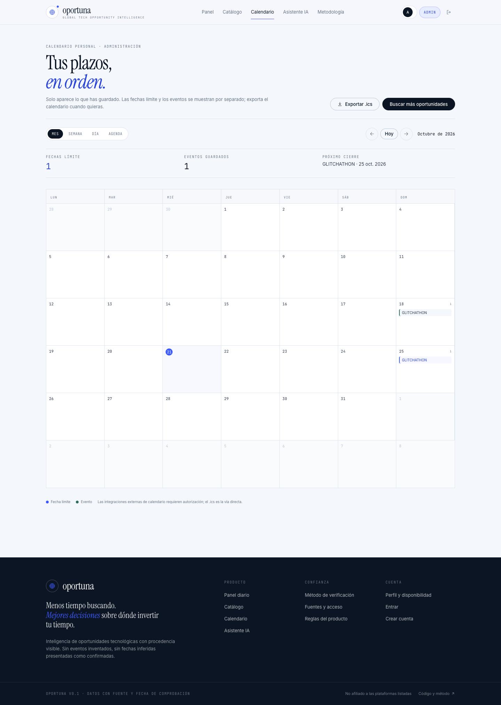

# Oportuna

**Inteligencia global de oportunidades tecnológicas.** Hackathons, eventos, becas, programas de investigación y convocatorias para founders, con fuente original, fecha de comprobación y una puntuación de confianza explicable.

> No es un agregador de eventos. Es una capa de decisión: descubre, verifica, deduplica, personaliza y te dice **qué hacer después**.

---

## Decisiones de producto ya tomadas

| Decisión | Elección |
| --- | --- |
| Nombre | **Oportuna** (antes “Radar Tech”) |
| Cobertura | **Amplia, con la incertidumbre etiquetada** |
| Publicación automática | **Estricta**: solo lo verificado se publica; lo dudoso va a una cola de revisión humana |
| Arranque | **Perfil, disponibilidad y recomendaciones desde la v1**, sin cerrar el catálogo abierto |

Estas decisiones están implementadas en código, no solo documentadas:

- `apps/api/oportuna/domain/trust.py` — confianza y compuertas de publicación.
- `apps/api/oportuna/domain/ranking.py` — pesos 30/25/20/15/10, diversidad y motivos.
- `apps/api/oportuna/ingest/pipeline.py` — deduplicación, procedencia, auditoría y revisión.
- `apps/web` — panel, catálogo, ficha, calendario, perfil, asistente, metodología y consola interna.

---

## Qué funciona hoy

| Área | Estado |
| --- | --- |
| Modelo de datos con procedencia por campo, fechas separadas, revisiones e historial | ✅ |
| Ingesta real desde Devpost, PyTorch Events, 4 calendarios universitarios y 1 RSS | ✅ |
| Deduplicación por URL, nombre, organizador, fechas, ubicación y similitud textual | ✅ |
| Cola de revisión para ambigüedades; nada ambiguo se publica solo | ✅ |
| Confianza explicable y estados Verificado / Pendiente / Contradicción / Cerrado | ✅ |
| Catálogo con búsqueda textual, filtros combinables, facets y paginación | ✅ |
| Ficha con fechas separadas, requisitos, premios, procedencia, historial y siguientes pasos | ✅ |
| Perfil progresivo, disponibilidad y ranking personalizado con motivos | ✅ |
| Guardadas, seguimiento, feedback de utilidad, calendario y exportación `.ics` | ✅ |
| Asistente con IA local (Ollama) sobre el catálogo verificado, con citas | ✅ |
| Automatización con worker + scheduler y alertas de cierre | ✅ |
| Panel de administración con fuentes, revisión, duplicados, métricas y auditoría | ✅ |
| Docker Compose con Postgres, Redis, API, worker, scheduler, web y nginx | 🟡 Config validada; build de imágenes no completado en este entorno |
| Integraciones MLH / Luma / Meetup / Eventbrite | ⏳ requieren credenciales o acceso expreso; documentado en [`docs/SOURCES.md`](docs/SOURCES.md) |
| Búsqueda recursiva de organizadores | ⏳ siguiente fase; hoy la expansión es por fuentes declarativas |
| Asistente con LLM | ⏳ el modo actual es determinista y cita fuentes; el LLM es opcional y está desactivado |

No hay datos de demostración presentados como reales. Si el catálogo está vacío, la interfaz lo dice.

---

## Capturas













## IA local

Oportuna usa **Ollama en tu equipo** (`gemma4:12b-q4` + `nomic-embed-text`). El asistente consulta el catálogo publicado, añade búsqueda semántica cuando hace falta, construye un contexto numerado y exige citas. Si el modelo falla, responde con reglas y lo indica.

```bash
ollama list
curl -s http://127.0.0.1:8000/api/assistant/status
```

Configuración y límites en [`docs/AI-LOCAL.md`](docs/AI-LOCAL.md).

## Arquitectura

```text
                    ┌──────────────────────────────────────────────┐
  navegador  ──────▶ │  nginx :8080  ──▶  web (Next.js 16)          │
                    │       │                                      │
                    │       └──────────▶  api (FastAPI) :8000      │
                    └───────────────────────────┬──────────────────┘
                                                │
        ┌───────────────────────────────────────┼────────────────────────────┐
        │                                       │                            │
   Postgres 16                              Redis 7                    Fuentes públicas
   oportunidades, usuarios,            cola de trabajos             Devpost · PyTorch
   fuentes, procedencia,               + scheduler                  Berkeley · MIT · Cornell
   cambios, revisiones,                                             Stanford · RSS
   alertas, métricas
```

- **Frontend**: Next.js 16 (App Router), React 19, TypeScript, Tailwind CSS 4.
- **Backend**: FastAPI, SQLAlchemy 2, Alembic, Pydantic 2.
- **Datos**: PostgreSQL 16; JSONB para etiquetas, premios, requisitos y señales.
- **Cola**: Redis + arq. `worker` procesa ingesta y alertas; `scheduler` encola por cadencia.
- **Proxy**: nginx (API bajo `/api`, web en `/`).
- **Sin ORM mágico en la lógica de confianza**: reglas de fechas, deduplicación y publicación son funciones puras y testeadas.

### Estructura

```text
apps/api/oportuna/
  domain/          # fechas, dedup, confianza, ranking, elegibilidad, ICS, taxonomía
  ingest/          # cliente HTTP, adaptadores, pipeline
  api/             # routers públicos, cuenta, admin, asistente, serializers
  db/              # modelos SQLAlchemy
  worker.py        # trabajos de ingesta, verificación y alertas
  scheduler.py     # encolado periódico
  seed.py          # registro de fuentes reales + admin opcional
apps/web/src/
  app/             # páginas
  components/      # sistema de diseño y componentes
  lib/             # API, tipos, formato, sesión
docs/              # especificación, fuentes, ranking, operación y backlog
```

---

## Arranque rápido con Docker

Requisitos: Docker Desktop (o Docker Engine + Compose v2). No hace falta Node ni Python en el host.

```bash
cp .env.example .env
# edita OPORTUNA_JWT_SECRET y OPORTUNA_SEED_ADMIN_PASSWORD antes de producción
docker compose up -d --build
```

Abre **<http://localhost:8080>**.

- La API y las migraciones arrancan solas (`entrypoint.sh`): `alembic upgrade head` + seed idempotente de fuentes.
- El worker y el scheduler quedan activos; el scheduler encola la primera ingesta al arrancar.
- Credenciales locales por defecto (cámbialas en `.env`): `admin@oportuna.local` / `oportuna-admin-2026`.
- Documentación de API: <http://localhost:8080/api/docs>.
- Health: `GET /api/health`; readiness con comprobación de base: `GET /api/ready`.

> **Nota de verificación local:** `docker compose config` es válido y los Dockerfiles están incluidos, pero la construcción de imágenes no pudo completarse en este equipo por un fallo del daemon/BuildKit (`EOF` durante la descarga de dependencias), no por el código. En un Docker Desktop saludable el camino previsto es `docker compose up -d --build`. La aplicación se verificó con Postgres/Redis en Docker y API/Web nativos.
>
> Los valores por defecto son **solo para desarrollo local**. En producción define un `OPORTUNA_JWT_SECRET` largo y una contraseña de administración real. El arranque falla si se detecta el secreto de desarrollo con `OPORTUNA_ENVIRONMENT=production`.

### Servicios

| Servicio | Puerto host | Función |
| --- | --- | --- |
| `nginx` | 8080 | Proxy único; `/api` → API, resto → web |
| `web` | interno 3000 | Next.js |
| `api` | 8000 | FastAPI + migraciones |
| `worker` | — | Ingesta, reverificación, alertas |
| `scheduler` | — | Encola ingesta y digest |
| `db` | 55432 | PostgreSQL 16 |
| `redis` | 56379 | Cola |

---

## Desarrollo local (sin Docker para la app)

```bash
# 1. Servicios de datos
docker compose up -d db redis

# 2. Backend
python3.11 -m venv .venv
.venv/bin/pip install -e "apps/api[dev]"
cd apps/api
../../.venv/bin/alembic upgrade head
OPORTUNA_SEED_ADMIN_EMAIL=admin@oportuna.local \
OPORTUNA_SEED_ADMIN_PASSWORD=oportuna-admin-2026 \
../../.venv/bin/python -m oportuna.seed
OPORTUNA_REDIS_URL=redis://127.0.0.1:56379/0 \
../../.venv/bin/uvicorn oportuna.main:app --reload --port 8000

# 3. Ingesta real (en otra terminal)
cd apps/api
../../.venv/bin/python -m oportuna.cli ingest
../../.venv/bin/python -m oportuna.cli stats

# 4. Frontend
cd apps/web
npm install
npm run dev   # http://localhost:3000 (rewrite /api → 127.0.0.1:8000)
```

> El nombre del paquete Python es `oportuna` (sin tilde). Los comandos usan ese identificador.

### Comandos útiles

```bash
make up            # docker compose up -d --build
make logs          # logs de todos los servicios
make migrate       # alembic upgrade head dentro del contenedor
make ingest        # ingesta manual
make test          # pytest
make lint          # ruff
make dev-api       # uvicorn local
make dev-web       # next dev
```

---

## Cómo se descubre y verifica

### Fuentes

Ver el detalle operativo en [`docs/SOURCES.md`](docs/SOURCES.md). Resumen:

| Fuente | Tipo | Qué aporta | Estado |
| --- | --- | --- | --- |
| Devpost | API JSON pública | Hackathons y envíos | Activa |
| PyTorch Events | JSON-LD schema.org | Conferencias, meetups y hackathons globales | Activa |
| UC Berkeley / MIT / Cornell / Stanford Events | iCalendar público | Charlas, seminarios y talleres | Activas |
| Opportunities For Africans | RSS | Becas y programas (África) | Activa, solo revisión |
| GitHub (topic:hackathon) | API pública | Pistas de repositorios, nunca convocatorias confirmadas | Deshabilitada |

Cada fuente declara `authority`, `frequency_minutes`, `allowed_domains`, condiciones de acceso y notas. Añadir una fuente `ics`, `rss` o `jsonld` **no requiere código**: se registra desde `/admin` o con el endpoint de fuentes.

### Reglas de ingesta

- Allowlist de dominio por fuente; `robots.txt` respetado salvo APIs públicas documentadas.
- Límite de frecuencia por dominio, tamaño máximo de respuesta, timeout y reintentos acotados.
- User-Agent identificable con contacto.
- Sin CAPTCHA solving, sin rotación de IPs, sin elusión de anti-bots.
- Los contenido externos se tratan como **datos**, nunca como instrucciones para el sistema.

### Verificación

La confianza combina señales observables: autoridad de la fuente, confirmación en el dominio/plataforma oficial, recencia, coherencia de fechas, enlace de registro y contradicciones. Cada ficha muestra los motivos.

Estados: **Verificado**, **Pendiente de verificar**, **Información contradictoria**, **Cerrado/finalizado**.

La publicación automática exige: estado verificado, confianza ≥ 0.70, fecha de celebración o plazo confirmado, enlace oficial, comprobación en los últimos 21 días y cero contradicciones. Todo lo demás queda en la cola de revisión del administrador.

**Una URL que responde 200 no significa que la inscripción esté abierta.** El estado de inscripción solo se afirma cuando la fuente lo declara; si no, se muestra como desconocido.

### Deduplicación

- URL canónica normalizada (sin parámetros de tracking).
- Nombre normalizado, organizador, edición/año, fechas, ciudad/país y modalidad.
- Similitud de tokens y de descripción.
- **Nunca se fusionan dos ediciones distintas**, y una misma página con fechas claramente distintas se trata como una serie recurrente, no como un duplicado.
- Los casos ambiguos crean un par en la cola de duplicados; no se fusionan solos.

---

## API (resumen)

Pública:

- `GET /api/dashboard` — resumen diario, prioridad, nuevas y cierres.
- `GET /api/opportunities` — catálogo con `q`, `category[]`, `tech[]`, `modality`, `country`, `language`, `cost`, `days`, `sort`, `page`.
- `GET /api/opportunities/{slug}` — ficha con procedencia, cambios y fuentes.
- `GET /api/opportunities/{slug}/ics` — exportación individual.
- `GET /api/taxonomy`, `/api/sources`, `/api/methodology`.
- `POST /api/assistant/ask` — consultas deterministas sobre el catálogo.

Cuenta:

- `POST /api/auth/register`, `/login`, `/logout`; `GET /api/auth/me`.
- `GET/PUT/DELETE /api/profile`; `DELETE /api/account?confirm=eliminar`.
- `GET /api/saved`, `PUT/PATCH/DELETE /api/saved/{slug}`.
- `GET /api/calendar`, `GET /api/calendar.ics`, `GET /api/alerts`.

Admin (rol `admin`):

- `GET /api/admin/stats`, `/sources`, `/review`, `/duplicates`, `/runs`, `/audit`, `/explain/{id}`.
- `POST /api/admin/sources`, `PATCH /api/admin/sources/{id}`, `POST /api/admin/sources/{id}/run`, `POST /api/admin/ingest`.
- `POST /api/admin/opportunities/{id}/approve|hide`, `PATCH /api/admin/opportunities/{id}`.
- `POST /api/admin/duplicates/{id}/resolve`.

La documentación interactiva está en `/api/docs`.

---

## Estado de verificación local

- **34 tests** de backend en verde (fechas, dedup, confianza, API, admin, asistente).
- `npx tsc --noEmit` y `npm run build` sin errores.
- Ingesta real ejecutada contra las 7 fuentes activas: **104 oportunidades publicadas** y 109 abiertas en el catálogo local.
- Flujo autenticado verificado con Chrome headless: registro, login, perfil, guardadas, calendario, ICS y consola de administración.
- Capturas reales en [`docs/screenshots`](docs/screenshots).
- Docker: `docker compose config` válido; la construcción de imágenes no se completó en este equipo por un fallo del daemon/BuildKit, no por los Dockerfiles.

## Tests


Cubre:

- Fechas: rangos Devpost, años explícitos, cruce de año, deadlines declarados, estados de ciclo de vida.
- Deduplicación: URL idéntica, edición distinta, series recurrentes, ambigüedad, no-duplicados.
- Confianza y compuertas de publicación.
- API: catálogo, filtros, auth, perfil, guardadas, calendario, ICS, admin, asistente y revisión.

Frontend:

```bash
cd apps/web
npx tsc --noEmit
npm run build
```

---

## Seguridad

- Contraseñas con **scrypt** (sal aleatoria); nunca en claro.
- Sesión JWT en cookie `HttpOnly`, `SameSite=Lax`, `Secure` cuando el sitio es HTTPS.
- Rate limit de login en memoria (adecuado para una instancia; usar Redis para varias réplicas).
- Secretos solo en el servidor; `.env` fuera de control de versiones.
- Contenido externo no confiable: sin ejecución de instrucciones embebidas, sin HTML sin escapar.
- Límites de consultas, tamaño y frecuencia en la ingesta.
- El usuario puede vaciar su perfil o eliminar su cuenta; no vendemos perfiles.

---

## Límites conocidos

- La cobertura sigue concentrada en fuentes en inglés y en Estados Unidos; hay señales de África, Uganda, Corea, Japón, Finlandia y Australia, pero no es cobertura global completa.
- MLH, Luma, Meetup y Eventbrite no están integrados: requieren API con credenciales, permisos o revisión de condiciones. No se simulan integraciones.
- El asistente no usa un LLM. Es deliberado: responde con reglas y datos publicados. El enriquecimiento con LLM está desactivado por defecto.
- La verificación automática de enlaces registra accesibilidad, no el estado de un formulario detrás de login.
- La estimación de esfuerzo/preparación solo se muestra cuando la fuente la publica; no se inventa.
- El coste de APIs es 0 hoy; el campo está listo para medir consumo futuro.

Ver [`docs/BACKLOG.md`](docs/BACKLOG.md) para el estado épica por épica y lo que falta.

---

## Documentación

- [`docs/SPEC.md`](docs/SPEC.md) — especificación funcional y criterios de aceptación.
- [`docs/DATA-MODEL.md`](docs/DATA-MODEL.md) — entidades, procedencia y reglas de fechas.
- [`docs/SOURCES.md`](docs/SOURCES.md) — fuentes verificadas, acceso y fuentes pendientes.
- [`docs/RANKING.md`](docs/RANKING.md) — fórmula, elegibilidad y diversidad.
- [`docs/RUNBOOK.md`](docs/RUNBOOK.md) — operación, incidencias y despliegue.
- [`docs/BACKLOG.md`](docs/BACKLOG.md) — épicas y estado real.
- [`docs/AI-LOCAL.md`](docs/AI-LOCAL.md) — IA local, privacidad, prompts y rendimiento.
- [`docs/GAPS.md`](docs/GAPS.md) — qué falta para operar en producción y qué depende de terceros.
